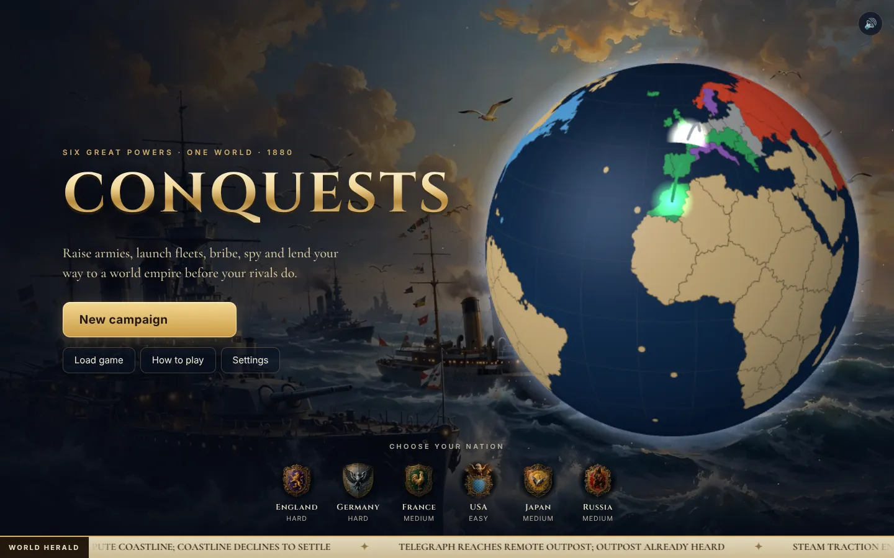
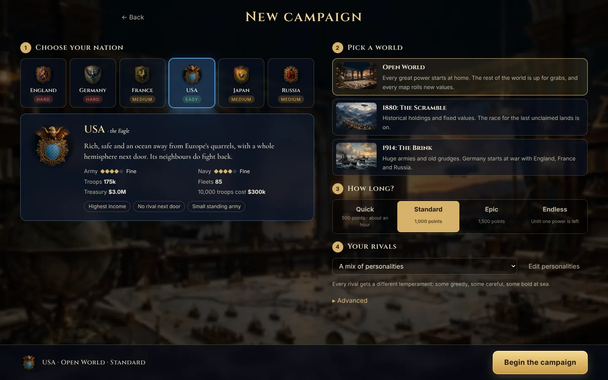
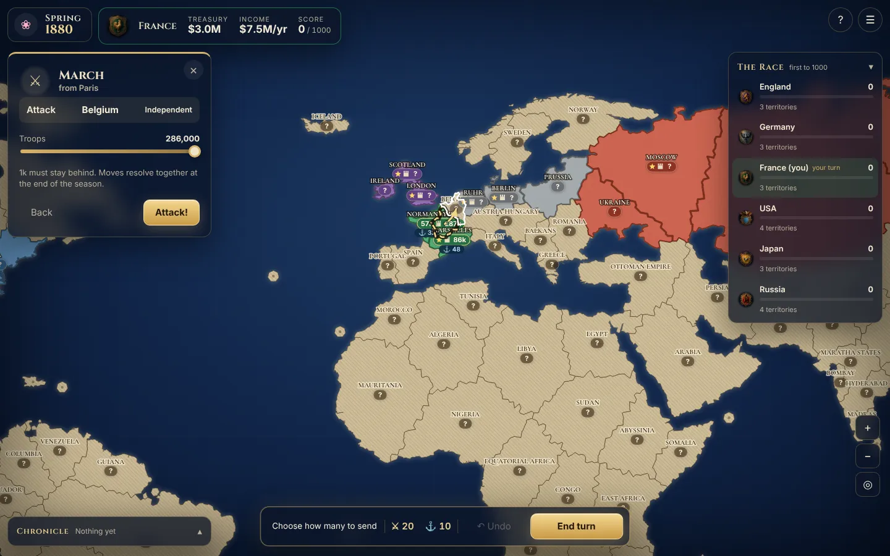
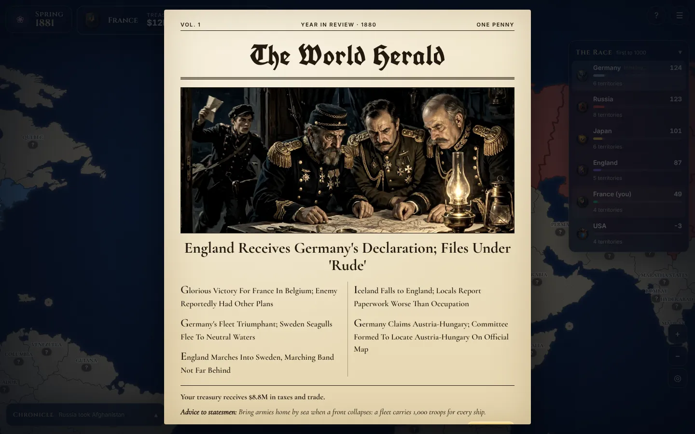

# Conquests

Grand strategy of rival empires, 1880 to 1914, in the browser. Lead one of six great powers (England,
Germany, France, the USA, Japan or Russia) and race the others for the world's 131 territories with
armies, fleets, fortresses, spies, bribes and loans. The first power to reach the winning score wins.



| | |
| --- | --- |
|  |  |
|  | |

## Quick start

```bash
npm install
npm run dev      # http://localhost:5173
```

Other scripts:

```bash
npm run build      # type-check + production build
npm run test       # engine and game tests (Vitest)
npm run typecheck  # strict type-check only
npm run sim        # headless all-AI games, persona scoreboard
npm run balance    # headless all-AI games, win rate per great power
npm run gen:world  # regenerate the precomputed world map
```

## Playing online

Online games run on the GameHub relay at games.futuremagic.de (app id `conquests`). The build needs
the game's key; put it in `.env.local` (git ignores it), next to `package.json`:

```bash
VITE_GAMEHUB_KEY=ghk_conquests_...
# optional: VITE_GAMEHUB_URL=https://games.futuremagic.de
```

Without a key the game still works offline and the Online screen says that online play is not set up.

How it works (`src/net/`):

- One player hosts. The host's browser runs the game; the others send what they want to do
  (an order, end turn, undo) and the host checks and applies it, then publishes the new state to
  everyone. State is gzipped (about 4 KB) and batched, so fast computer turns stay cheap.
- In the lobby everyone takes a nation; the computer plays the rest. Invite links are `?room=CODE`.
- A player who drops out is replaced by the computer until they come back (reload or reopen the
  link in the same tab: the seat token lives in that tab). If the host leaves, the next player's
  browser takes over the game.
- Every browser has the whole game state, so a player who opens the developer tools could peek at
  hidden garrisons. That is the usual trade-off for a host-run game on a plain relay.
- `src/net/online.test.ts` plays a lobby, a turn and a host hand-over against an in-memory relay
  (`src/net/fakeHub.ts`).

## How a turn works

- A year has four seasons. Every power acts once per season, in a fixed order, then all moves resolve
  at once in the combat phase.
- In **spring** you can build armies and fleets at your supply centres, fortify, send loans, spy and bribe.
  (In the very first spring only spying, bribing and movement are allowed.)
- Every season you can march armies to neighbouring areas and sail fleets (each carrying up to 1,000
  troops) from port to port.
- Armies of one power that march into the same area fight together. Taking an area earns its victory
  points; losing a battle costs a point.
- Income arrives every spring. A power that loses its last area is out; the last one standing wins.

## Architecture

- `src/engine/` is a pure rules engine (no React), so it runs headless for tests, the AI and the
  multiplayer host.
  - `ruleset/` holds every balance number in one `RuleSet` object.
  - `world/` defines the map: real longitude/latitude for each territory, borders grown from a Voronoi
    mesh clipped to a real coastline, precomputed into `world/data/earth.generated.json`.
    `scenarios.ts` sets starting positions, start years and regional garrison strength.
  - `state/` holds the serializable `GameState`, the `Action`s, a seeded RNG, the reducer, combat,
    scoring, save/load, and `turn.ts` (`advanceAfterCombat`: combat, eliminations, new season, income,
    victory check).
- `src/controllers/` has interchangeable human and AI players (`PlayerController`).
- `src/game/gameRunner.ts` asks each power's controller for actions and drives the turn loop.
- `src/ui/` is the React front end:
  - `title/` the title screen: a three.js globe on which a real all-AI game plays itself, Ken Burns
    paintings, an animated logo and a World Herald ticker (try the Konami code).
  - `newgame/` nation, scenario, game length and rival personalities, plus the persona editor and
    crash tester.
  - `map/` a canvas renderer with pan, zoom, pinch, fling and animated battles, captures and spies.
  - `game/` the HUD, the race standings, the orders panel, the World Herald newspaper, the guide and
    settings.
  - `audio/` music by mood with cross-fades, sound effects and voice lines.
- `public/art` and `public/audio` hold paintings, crests, music, effects and voice lines, all generated
  with models on OpenRouter. `docs/ASSETS.md` lists the models and prompts; the game needs no key or
  network at run time.

The engine is deterministic: the same seed and actions give the same game, and illegal actions throw
instead of being ignored.

`docs/AUDIT.md` lists what an audit of the game found and what was fixed.
